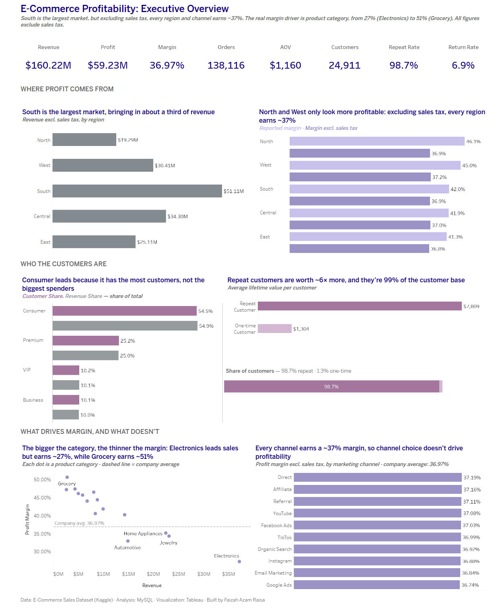
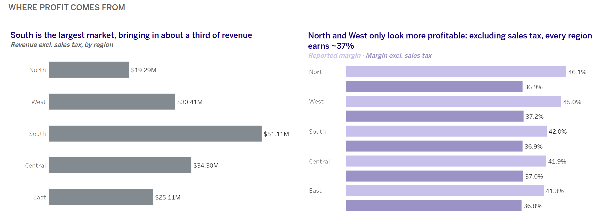
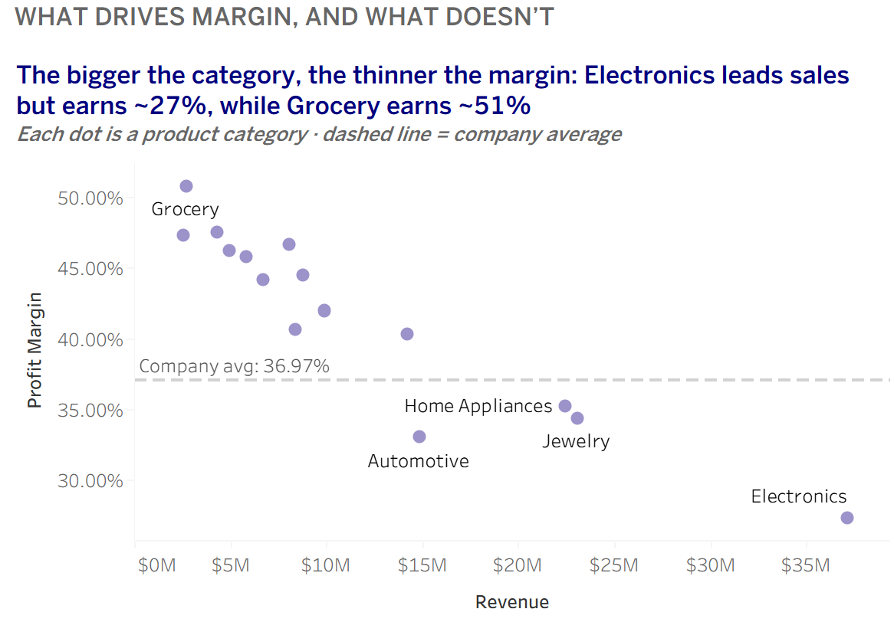

# E-Commerce Profitability Analysis

**What really drives margin, and why the reported numbers were misleading**

SQL (MySQL) · Tableau · Business Analysis

**[View the interactive dashboard on Tableau Public](https://public.tableau.com/app/profile/faizah.azam.raisa/viz/E-CommerceProfitabilityAnalysis_17923807168430/ExecutiveOverview)** · **[Read the full report](report/E-commerce_Profitability_Analysis_Report.pdf)** · **[See the SQL](sql/ecommerce_profitability_analysis.sql)**



---

## The business question

Revenue alone doesn't show how healthy a business is. A region, product or channel can sell a lot while keeping very little of each dollar as profit. I set out to answer one question:

> **Which parts of the business generate strong revenue but weak profit, and what should management do about it?**

I analyzed **138,116 orders** from **24,911 customers** across 5 regions, 15 product categories, 4 customer segments and 10 marketing channels.

---

## Key findings

| # | Finding | Evidence |
|---|---|---|
| 1 | **The reported regional profit gap isn't real.** North and West appeared to earn ~5 points more margin than other regions. The cause was a metric issue: the dataset counts **sales tax as revenue and profit**. | Excluding tax, every region earns **36.8%–37.2%** |
| 2 | **Reported revenue and profit are overstated by $16.9M.** | Revenue $160.2M (not $177.1M), profit $59.2M (not $76.2M), true margin **37.0%** (not 43.0%) |
| 3 | **Product category is the real margin driver.** | Ex-tax margins range from **27% (Electronics, the largest category) to 51% (Grocery)**, driven by product cost, not discounts |
| 4 | **Repeat customers are worth ~6× more, purely through frequency.** | 98.7% of customers return; lifetime value $7,809 vs $1,304, but spend per order is the same (~$1,280) |
| 5 | **Channel, segment, discounts, shipping, ratings and returns don't explain profit differences.** | All 10 channels earn 36.7%–37.2% excluding tax |

---

## How I found the sales tax issue

The reported data showed a clear pattern: **North (46.1%) and West (45.0%) margins were well above East (41.3%)**. Before recommending that other regions "copy North", I tested six possible explanations:

| Hypothesis | Result |
|---|---|
| Higher shipping costs | ❌ Shipping is 1.5–1.9% of sales everywhere |
| Heavier discounting | ❌ ~17% of list price in every region |
| Product mix (more low-margin Electronics) | ❌ Electronics is ~21% of sales in every region |
| Lower customer satisfaction | ❌ Ratings 3.67–3.68 everywhere |
| More returns | ❌ Return rates 6.4–7.1%, with no link to margin |
| Paying more for products | ❌ Cost per unit is ~$126 in every region |

Unit costs were identical, so the gap had to come from the **revenue** side. Breaking net price down per unit showed that **list price, discount and shipping were the same everywhere, but sales tax was not**: North collects $34.05 of tax per unit versus $16.51 in East.

I then confirmed the definition on all 138,116 rows (0 mismatches):

```
net_sales = gross_sales − discount + tax + shipping
```

Because tax is collected for the government and not kept by the business, I recalculated every metric **excluding sales tax**. The 4.8-point regional gap shrank to **0.4 points**, and North dropped from first place to third.



---

## Recommendations

1. **Correct the profit metric before making regional decisions.** Report revenue and profit excluding sales tax, and net out refunded returns. Regional rankings reverse once tax is removed.
2. **Improve Electronics margin and grow high-margin categories.** Electronics keeps only 27 cents per ex-tax dollar because product cost takes 72%. Each 1-point improvement is worth ~$0.4M in profit.
3. **Grow order frequency among existing repeat customers.** Nearly all customers already return. A 10% increase in order frequency would add ~$17M in revenue and ~$6M in profit (excluding tax).



---

## Tools and skills

| Area | What I did |
|---|---|
| **SQL (MySQL 8.0)** | Data cleaning and type casting, NULL handling, joins across 3 tables, CTEs, window functions (`RANK`, `SUM() OVER`), CROSS JOIN benchmarking, data validation checks |
| **Tableau** | Calculated fields, LOD expressions (`FIXED`), reference lines, filter actions, an executive dashboard with insight-led titles |
| **Analysis** | KPI design, hypothesis testing by elimination, metric validation, customer-level vs order-level aggregation, opportunity sizing |
| **Communication** | Written report with methodology, recommendations and limitations |

---

## Repository structure

```
├── README.md
├── sql/
│   └── ecommerce_profitability_analysis.sql   # All queries, organized in 12 sections, with results in comments
├── report/
│   ├── E-commerce_Profitability_Analysis_Report.pdf
│   └── E-commerce_Profitability_Analysis_Report.docx
└── images/
    ├── dashboard.png
    ├── region_margin.png
    └── category_scatter.png
```

**SQL file sections:** 1–2 data exploration and quality checks · 3–4 cleaning and loading · 5 headline KPIs · 6 regional analysis · 7 sales tax investigation · 8 customer analysis · 9–10 channels and returns · 11 product analysis · 12 export for Tableau

---

## Data

**Source:** E-Commerce Sales Dataset (Kaggle), loaded into MySQL as three related tables:

| Table | Grain |
|---|---|
| `ecommerce_sales_clean` | One row per order (138,116 rows) |
| `order_items` | One row per product within an order |
| `product_catalog` | One row per product |

The raw data isn't included in this repository because of its size. It is available on Kaggle as the E-Commerce Sales Dataset.

---

## Methodology notes

- **Revenue and profit exclude sales tax** throughout the dashboard and report.
- **Margins are calculated from totals** (sum of profit ÷ sum of revenue), not as an average of row-level margins.
- **Customer lifetime value is averaged at customer level.** The CLV column repeats on every order, so averaging at order level counts frequent buyers several times. My first version did this and overstated repeat-customer value ($8,990); the corrected figure is $7,809.

## Limitations

- No order date, so trends and seasonality couldn't be analyzed.
- Profit excludes overheads (marketing, salaries, rent), so margins are closer to gross margin than net margin.
- Returned orders keep their full profit, so even the ex-tax profit may be overstated.
- No customer acquisition cost data, so channel efficiency couldn't be measured.
- Discounts, unit costs and channel margins are unusually uniform, which suggests the dataset may be synthetic. The findings illustrate the analytical approach rather than a real company.

---

## About me

**Faizah Azam Raisa**, MS Business Analytics (Big Data), University of Massachusetts Boston

[LinkedIn](https://www.linkedin.com/in/faizah-azam-raisa/) · [Tableau Public](https://public.tableau.com/app/profile/faizah.azam.raisa/vizzes) · [GitHub](https://github.com/FaizahAzamRaisa)
